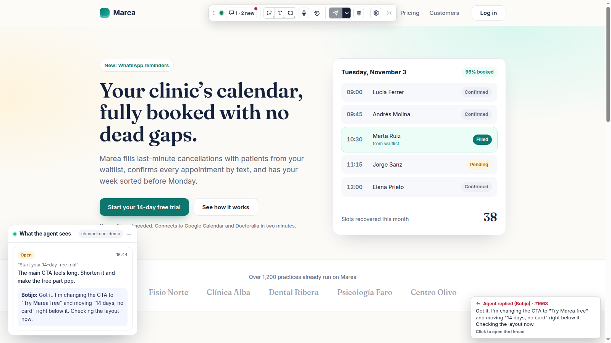

# Arcilla

In Private Beta.

Arcilla is a surface prompting SDK. Instead of describing changes in a chat, you prompt your coding agent by pointing at, dragging and editing the artifact itself: a UI in development, a proposal, a contract or a deck.

